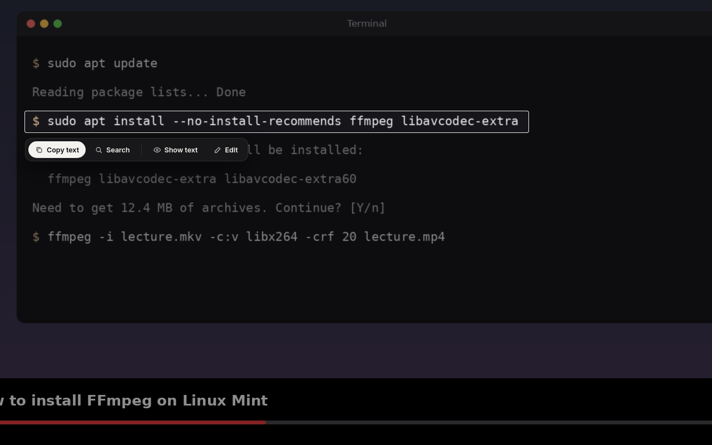
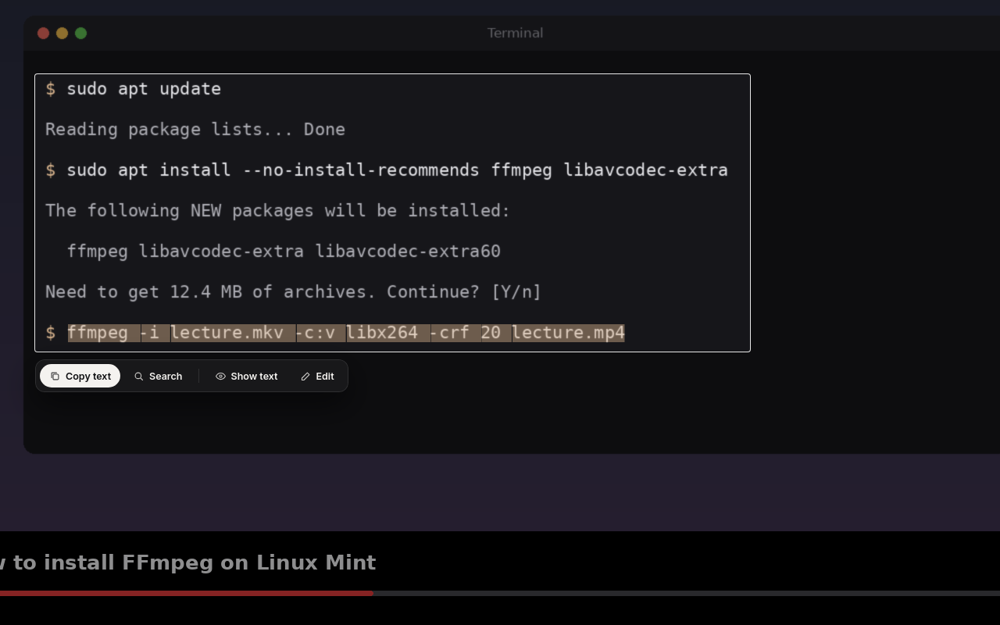
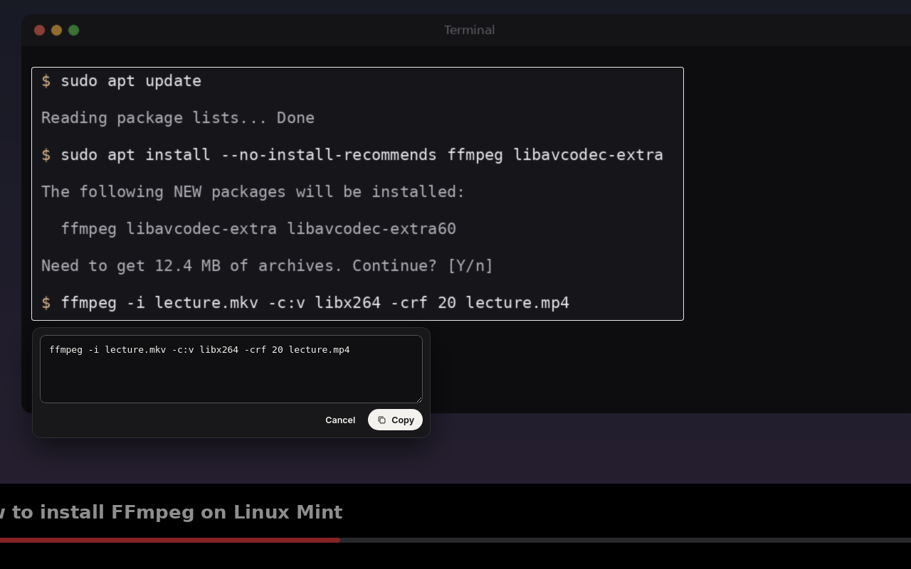

# Pluck

Copy text from anything on your screen: a paused video, a screenshot, a
photo, a game, a PDF that's really an image.



<table>
  <tr>
    <td width="50%"></td>
    <td width="50%"></td>
  </tr>
  <tr>
    <td>Select part of it with the mouse, right on the original.</td>
    <td>Check and fix what was read before copying.</td>
  </tr>
</table>

Press **Super+Shift+T**. The screen freezes (so moving video holds still) and
dims; drag over what you want. Pluck reads it and lays the text invisibly over
the original pixels, so you can select part of it with the mouse, or:

- **Copy text** (or press Enter or Ctrl+C), and Pluck closes
- **Open** a link it found, **Email** an address, **Copy** a phone number
- **Search** the web for it
- **Show text** to check what was read, and **Edit** to fix it before copying

Everything runs on your computer. Nothing is sent anywhere unless you press
Search or open a link.

## Install

On Linux Mint, Ubuntu or Debian:

```sh
sudo apt install tesseract-ocr python3-gi python3-pil gir1.2-webkit2-4.1
git clone https://github.com/BeansAsset/pluck.git ~/pluck
~/pluck/install-integration.sh
```

The last step adds Pluck to your apps menu, starts it quietly at login so the
shortcut responds instantly, and sets **Super+Shift+T** (Super is the Windows
key) on Cinnamon. Elsewhere, bind a shortcut to `~/pluck/pluck-app` in your
keyboard settings. `install-integration.sh --remove` undoes all of it.

Reads English for now. Works on X11, which is Linux Mint's default.

## Run it by hand

```sh
./pluck-app                  # freeze the screen and select
./pluck-app --background     # start quietly, ready for the shortcut
```

## How well it reads

Measured on screen-style text at 11 to 16 px, light and dark:

| Text | Accuracy |
| --- | --- |
| Clean screen text | 99.7% |
| Blurred, like a paused video | 99.5% |
| Heavily compressed (JPEG) | 99.4% |
| On a coloured background | 99.7% |

Two fixes for things that went wrong on real screens:

- In monospace fonts a lowercase `l` has a curved foot and was read as `L`
  (`Libavcodec`). On lines that look like code, Pluck fixes a leading `L` in
  an otherwise lowercase word. Normal sentences are left alone.
- Tesseract sometimes splits one token in two (`download. html`). Pieces that
  touch, joined by punctuation, are put back together.

Known limits: a lone `l` can come out as `|`, and very small or stylised text
(game fonts, logos) reads worse. Show text and Edit are there for that.

## How it works

`engine.py` crops the selected area from the frozen screen, enlarges it 2x,
turns it into dark-on-light grayscale and runs Tesseract, which returns each
word with its position. The page (`web/`) places a transparent copy of every
word exactly over the original, which is what makes mouse selection line up.
Pluck stays running between uses: the shortcut responds instantly, and copied
text stays on the clipboard after the overlay closes.

```
pluck/
  engine.py   OCR: prepare, recognise, positions, fixes, links and numbers
  main.py     the app: capture, the full-screen overlay, clipboard, actions
  web/        the overlay (HTML, CSS, JS, Inter font)
tests/        python3 -m unittest discover -s tests
```

Wayland needs the desktop's screenshot portal instead of a direct capture;
not done yet.

## License

GPL-3.0-or-later (`LICENSE`). Inter is under the SIL Open Font License 1.1.
